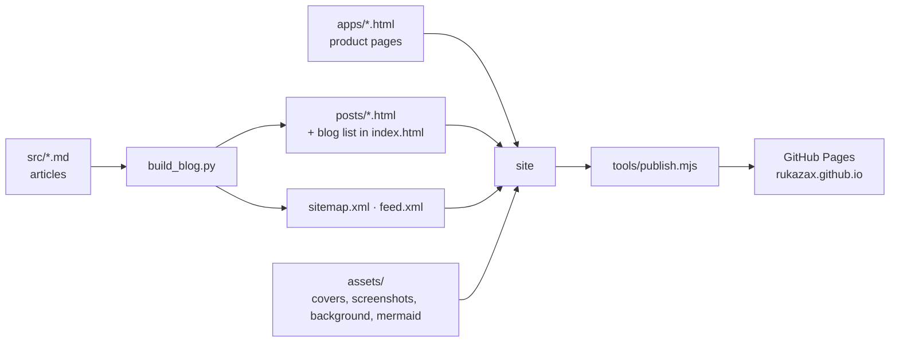

# rukazax.github.io — site, products and blog

[Русский](README.ru.md) | **English**

Developer's portfolio and blog: services, product pages and technical write-ups.
The site is plain static HTML published with GitHub Pages — no server side, no external CMS.

**Site:** https://rukazax.github.io/ · **Русская версия:** https://rukazax.github.io/

## What is on the site

| Section | URL | Contents |
|---|---|---|
| Services | [/](https://rukazax.github.io/) | offer, workflow, stack, request form |
| Russian landing | [/index.html](https://rukazax.github.io/index.html) | the same landing in Russian |
| Private SpeedDial | [/apps/private-speeddial.html](https://rukazax.github.io/apps/private-speeddial.html) | bookmarks and notes for Chrome and Android |
| XIO | [/apps/xio-vpn.html](https://rukazax.github.io/apps/xio-vpn.html) | a VPN on your own servers: Android, Ubuntu, Windows |
| x1o | [/apps/x1o.html](https://rukazax.github.io/apps/x1o.html) | self-hosted platform for personal AI assistants |
| ECONA | [/apps/econa.html](https://rukazax.github.io/apps/econa.html) | research concept of a kite–solar catamaran |
| Blog | [/#blog](https://rukazax.github.io/#blog) | product write-ups and the DeepSeek Harness localisation story |
| RSS | [/feed.xml](https://rukazax.github.io/feed.xml) | blog feed |

## How it is built



Articles are written in Markdown (`src/<slug>.md`); `build_blog.py` renders the `posts/` pages,
updates the article list on the landing page and regenerates `sitemap.xml` and `feed.xml`.
The landings (`index.html`, `en.html`), product pages and `404.html` are plain HTML files in the
shared style; `assets/site.css` and `assets/app.js` handle themes, the mobile menu, the request
modal and its messages in both languages.

## Repository layout

```
index.html              services landing (RU)
en.html                 services landing (EN)
404.html                "not found" page in the site style
apps/                   product pages: private-speeddial, xio-vpn, x1o, econa
posts/                  blog articles (generated HTML)
src/                    article sources in Markdown
assets/                 site.css, app.js, covers, screenshots, ECONA renders, mermaid
build_blog.py           build: articles, article list, sitemap.xml, feed.xml
sitemap.xml             sitemap (generated)
feed.xml                blog RSS feed (generated)
tools/login.mjs         GitHub device-flow login, stores the token
tools/publish.mjs       publish the folder to GitHub Pages via the REST API
tools/publish_site.mjs  publish from the repository (alternative script)
tools/status.mjs        GitHub connection diagnostics
tools/check_links.py    link check: local files, anchors, external URLs
tools/make_covers.py    generate 1200×630 covers in the site style
.publishignore          what is not published to the repository (tools)
```

## Build and publish

```bash
python build_blog.py            # articles, article list, sitemap.xml, feed.xml
python build_blog.py --check    # write nothing, compare with what is on disk
python tools/check_links.py     # broken links: local files, anchors, external URLs

node tools/login.mjs            # once: GitHub device-flow login
node tools/publish.mjs          # upload the folder to GitHub Pages
```

The token needs the `repo` scope and lives outside the repository:
`%USERPROFILE%\.dsh\secrets\github.json` (`{"token": "...", "login": "rukazax"}`).
Publishing is idempotent and atomic: files whose git-blob sha matches are skipped, and all changes
go out as **one commit** (Git Data API: blob → tree → commit → ref), so there are no “update <file>”
commits and no half-published state.

## Site features

| Feature | Implementation |
|---|---|
| Dark and light themes | CSS variables + `localStorage`, forced with `?theme=light` |
| Header that never collapses | sticky bar, “burger” only below 900 px |
| Request form | modal, posts to `rukazax@gmail.com` without a mail client; RU/EN messages from the page `lang` |
| Two languages | `index.html` (RU) and `en.html` (EN) with a switch in the header |
| Diagrams | Mermaid (local copy) and static PNGs |
| Product pages | one shared template with header, menu and phone |
| Discoverability | `sitemap.xml`, `feed.xml`, a styled `404.html` |

## Products

- **Private SpeedDial** — bookmarks and notes for Chrome and Android, synced to your own cloud
  (AES-GCM, WebDAV/Nextcloud): https://github.com/rukazax/Private_SpeedDial
- **XIO** — a VPN on your own servers: VPS setup over SSH, Xray/REALITY, RIVET, AWG and Cloak;
  Android, Ubuntu, Windows: https://github.com/rukazax/xio_vpn
- **x1o** — self-hosted platform for personal AI assistants: one API, dialogue queue, spend tracking,
  push notifications. Private repository, no public site.
- **ECONA** — research concept of an ocean-going kite–solar–electric catamaran:
  https://github.com/rukazax/econa · https://rukazax.github.io/econa/

## Contacts

Konstantin · [rukazax@gmail.com](mailto:rukazax@gmail.com) · [+7 (999) 802-40-40](tel:+79998024040) · [github.com/rukazax](https://github.com/rukazax)

## License

Site code and templates — MIT (see [LICENSE](LICENSE)). Article texts and images —
© Konstantin Eremin, reuse by agreement.
