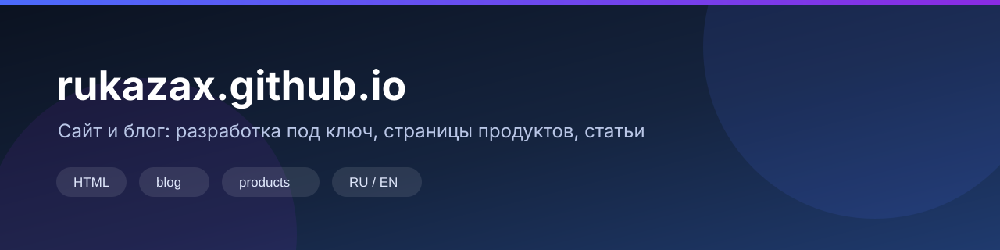
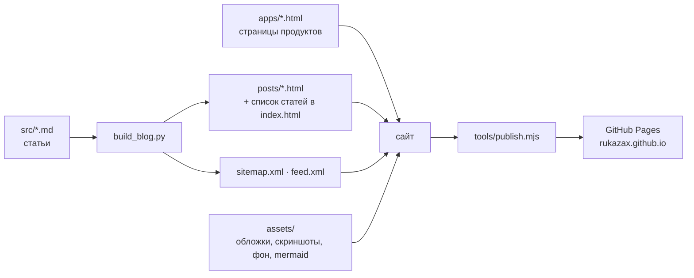
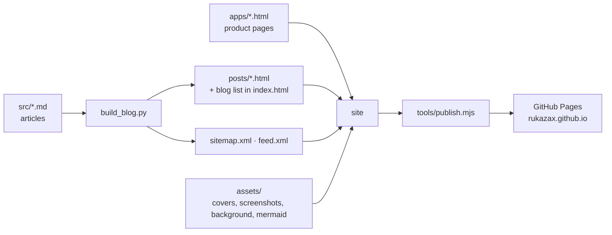

<div align="center">
  
</div>

# rukazax.github.io — сайт, продукты и блог

**RU** · [English](#english)

[](https://github.com/rukazax)


[](LICENSE)

> Сайт и блог: разработка под ключ, страницы продуктов и статьи.

Портфолио разработчика и блог: услуги, страницы продуктов и технические статьи.
Сайт — чистый статический HTML на GitHub Pages: без серверной части и без внешней CMS.

**Сайт:** https://rukazax.github.io/ · **Русская версия:** https://rukazax.github.io/

## Содержание

| Раздел | О чём |
|---|---|
| [Что на сайте](#что-на-сайте) | карта разделов и продуктов |
| [Как устроен сайт](#как-устроен-сайт) | Markdown → build_blog.py → HTML → Pages |
| [Структура репозитория](#структура-репозитория) | что где лежит |
| [Сборка и публикация](#сборка-и-публикация) | команды, токен, атомарный коммит |
| [Возможности сайта](#возможности-сайта) | темы, меню, форма заявки, два языка |
| [Продукты](#продукты) | Private SpeedDial, XIO, x1o, ECONA |
| [Контакты](#контакты) | как связаться |
| [Лицензия](#лицензия) | MIT для кода, © для текстов |

## Что на сайте

| Раздел | URL | Содержимое |
|---|---|---|
| Услуги | [/](https://rukazax.github.io/) | предложение, процесс, стек, форма заявки |
| Русский лендинг | [/index.html](https://rukazax.github.io/index.html) | тот же лендинг на русском |
| Private SpeedDial | [/apps/private-speeddial.html](https://rukazax.github.io/apps/private-speeddial.html) | закладки и заметки для Chrome и Android |
| XIO | [/apps/xio-vpn.html](https://rukazax.github.io/apps/xio-vpn.html) | VPN на своих серверах: Android, Ubuntu, Windows |
| x1o | [/apps/x1o.html](https://rukazax.github.io/apps/x1o.html) | self-hosted платформа личных AI-ассистентов |
| ECONA | [/apps/econa.html](https://rukazax.github.io/apps/econa.html) | исследовательский концепт кайт-солнечного катамарана |
| Блог | [/#blog](https://rukazax.github.io/#blog) | статьи о продуктах и история локализации DeepSeek Harness |
| RSS | [/feed.xml](https://rukazax.github.io/feed.xml) | лента блога |

## Как устроен сайт



Статьи пишутся в Markdown (`src/<slug>.md`); `build_blog.py` собирает страницы `posts/`,
обновляет список статей на лендинге и перегенерирует `sitemap.xml` и `feed.xml`.
Лендинги (`index.html`, `en.html`), страницы продуктов и `404.html` — обычные HTML-файлы
в общем стиле; `assets/site.css` и `assets/app.js` отвечают за темы, мобильное меню,
модалку заявки и её сообщения на обоих языках.

## Структура репозитория

```
index.html              лендинг услуг (RU)
en.html                 лендинг услуг (EN)
404.html                страница «не найдено» в стиле сайта
apps/                   страницы продуктов: private-speeddial, xio-vpn, x1o, econa
posts/                  статьи блога (сгенерированный HTML)
src/                    исходники статей в Markdown
assets/                 site.css, app.js, обложки, скриншоты, рендеры ECONA, mermaid
build_blog.py           сборка: статьи, список статей, sitemap.xml, feed.xml
sitemap.xml             карта сайта (генерируется)
feed.xml                RSS-лента блога (генерируется)
tools/login.mjs         вход на GitHub через device-flow, хранит токен
tools/publish.mjs       публикация папки на GitHub Pages через REST API
tools/publish_site.mjs  публикация из репозитория (альтернативный скрипт)
tools/status.mjs        диагностика подключения к GitHub
tools/check_links.py    проверка ссылок: локальные файлы, якоря, внешние URL
tools/make_covers.py    генерация обложек 1200×630 в стиле сайта
.publishignore          что не публикуется в репозиторий (tools)
```

## Сборка и публикация

```bash
python build_blog.py            # статьи, список статей, sitemap.xml, feed.xml
python build_blog.py --check    # ничего не пишет, сравнивает с тем, что на диске
python tools/check_links.py     # битые ссылки: локальные файлы, якоря, внешние URL

node tools/login.mjs            # один раз: вход на GitHub через device-flow
node tools/publish.mjs          # загрузка папки на GitHub Pages
```

Токену нужен скоуп `repo`; он живёт вне репозитория:
`%USERPROFILE%\.dsh\secrets\github.json` (`{"token": "...", "login": "rukazax"}`).
Публикация идемпотентна и атомарна: файлы с совпавшим git-blob sha пропускаются, а все изменения
уходят **одним коммитом** (Git Data API: blob → tree → commit → ref) — никаких коммитов
«обновил файл» и никаких наполовину опубликованных состояний.

## Возможности сайта

| Возможность | Реализация |
|---|---|
| Тёмная и светлая темы | CSS-переменные + `localStorage`, принудительно через `?theme=light` |
| Шапка, которая не сворачивается | sticky-панель, «бургер» только ниже 900 px |
| Форма заявки | модалка, отправляет на `rukazax@gmail.com` без почтового клиента; сообщения RU/EN из `lang` страницы |
| Два языка | `index.html` (RU) и `en.html` (EN) с переключателем в шапке |
| Диаграммы | Mermaid (локальная копия) и статичные PNG |
| Страницы продуктов | один общий шаблон с шапкой, меню и телефоном |
| Находимость | `sitemap.xml`, `feed.xml`, стилизованная `404.html` |

## Продукты

- **Private SpeedDial** — закладки и заметки для Chrome и Android с синхронизацией в своё облако
  (AES-GCM, WebDAV/Nextcloud): https://github.com/rukazax/Private_SpeedDial
- **XIO** — VPN на своих серверах: настройка VPS по SSH, Xray/REALITY, RIVET, AWG и Cloak;
  Android, Ubuntu, Windows: https://github.com/rukazax/xio_vpn
- **x1o** — self-hosted платформа личных AI-ассистентов: один API, очередь диалогов, учёт
  расходов, push-уведомления. Приватный репозиторий, публичного сайта нет.
- **ECONA** — исследовательский концепт океанского кайт-солнечно-электрического катамарана:
  https://github.com/rukazax/econa · https://rukazax.github.io/econa/

## Контакты

Константин · [rukazax@gmail.com](mailto:rukazax@gmail.com) · [+7 (999) 802-40-40](tel:+79998024040) · [github.com/rukazax](https://github.com/rukazax)

## Лицензия

Код и шаблоны сайта — MIT (см. [LICENSE](LICENSE)). Тексты статей и изображения —
© Константин Еремин, повторное использование по договорённости.

## English

rukazax.github.io — site, products and blog: custom development, product pages and articles.

Developer's portfolio and blog: services, product pages and technical write-ups.
The site is plain static HTML published with GitHub Pages — no server side, no external CMS.

**Site:** https://rukazax.github.io/ · **Русская версия:** https://rukazax.github.io/

### What is on the site

| Section | URL | Contents |
|---|---|---|
| Services | [/](https://rukazax.github.io/) | offer, workflow, stack, request form |
| Russian landing | [/index.html](https://rukazax.github.io/index.html) | the same landing in Russian |
| Private SpeedDial | [/apps/private-speeddial.html](https://rukazax.github.io/apps/private-speeddial.html) | bookmarks and notes for Chrome and Android |
| XIO | [/apps/xio-vpn.html](https://rukazax.github.io/apps/xio-vpn.html) | a VPN on your own servers: Android, Ubuntu, Windows |
| x1o | [/apps/x1o.html](https://rukazax.github.io/apps/x1o.html) | self-hosted platform for personal AI assistants |
| ECONA | [/apps/econa.html](https://rukazax.github.io/apps/econa.html) | research concept of a kite–solar catamaran |
| Blog | [/#blog](https://rukazax.github.io/#blog) | product write-ups and the DeepSeek Harness localisation story |
| RSS | [/feed.xml](https://rukazax.github.io/feed.xml) | blog feed |

### How it is built



Articles are written in Markdown (`src/<slug>.md`); `build_blog.py` renders the `posts/` pages,
updates the article list on the landing page and regenerates `sitemap.xml` and `feed.xml`.
The landings (`index.html`, `en.html`), product pages and `404.html` are plain HTML files in the
shared style; `assets/site.css` and `assets/app.js` handle themes, the mobile menu, the request
modal and its messages in both languages.

### Repository layout

```
index.html              services landing (RU)
en.html                 services landing (EN)
404.html                "not found" page in the site style
apps/                   product pages: private-speeddial, xio-vpn, x1o, econa
posts/                  blog articles (generated HTML)
src/                    article sources in Markdown
assets/                 site.css, app.js, covers, screenshots, ECONA renders, mermaid
build_blog.py           build: articles, article list, sitemap.xml, feed.xml
sitemap.xml             sitemap (generated)
feed.xml                blog RSS feed (generated)
tools/login.mjs         GitHub device-flow login, stores the token
tools/publish.mjs       publish the folder to GitHub Pages via the REST API
tools/publish_site.mjs  publish from the repository (alternative script)
tools/status.mjs        GitHub connection diagnostics
tools/check_links.py    link check: local files, anchors, external URLs
tools/make_covers.py    generate 1200×630 covers in the site style
.publishignore          what is not published to the repository (tools)
```

### Build and publish

```bash
python build_blog.py            # articles, article list, sitemap.xml, feed.xml
python build_blog.py --check    # write nothing, compare with what is on disk
python tools/check_links.py     # broken links: local files, anchors, external URLs

node tools/login.mjs            # once: GitHub device-flow login
node tools/publish.mjs          # upload the folder to GitHub Pages
```

The token needs the `repo` scope and lives outside the repository:
`%USERPROFILE%\.dsh\secrets\github.json` (`{"token": "...", "login": "rukazax"}`).
Publishing is idempotent and atomic: files whose git-blob sha matches are skipped, and all changes
go out as **one commit** (Git Data API: blob → tree → commit → ref), so there are no "update file"
commits and no half-published state.

### Site features

| Feature | Implementation |
|---|---|
| Dark and light themes | CSS variables + `localStorage`, forced with `?theme=light` |
| Header that never collapses | sticky bar, "burger" only below 900 px |
| Request form | modal, posts to `rukazax@gmail.com` without a mail client; RU/EN messages from the page `lang` |
| Two languages | `index.html` (RU) and `en.html` (EN) with a switch in the header |
| Diagrams | Mermaid (local copy) and static PNGs |
| Product pages | one shared template with header, menu and phone |
| Discoverability | `sitemap.xml`, `feed.xml`, a styled `404.html` |

### Products

- **Private SpeedDial** — bookmarks and notes for Chrome and Android, synced to your own cloud
  (AES-GCM, WebDAV/Nextcloud): https://github.com/rukazax/Private_SpeedDial
- **XIO** — a VPN on your own servers: VPS setup over SSH, Xray/REALITY, RIVET, AWG and Cloak;
  Android, Ubuntu, Windows: https://github.com/rukazax/xio_vpn
- **x1o** — self-hosted platform for personal AI assistants: one API, dialogue queue, spend tracking,
  push notifications. Private repository, no public site.
- **ECONA** — research concept of an ocean-going kite–solar–electric catamaran:
  https://github.com/rukazax/econa · https://rukazax.github.io/econa/

### Contacts

Konstantin · [rukazax@gmail.com](mailto:rukazax@gmail.com) · [+7 (999) 802-40-40](tel:+79998024040) · [github.com/rukazax](https://github.com/rukazax)

### License

Site code and templates — MIT (see [LICENSE](LICENSE)). Article texts and images —
© Konstantin Eremin, reuse by agreement.

---

#blog #github-pages #static-site #html #python #portfolio #rss #multilingual #dark-theme #mermaid
