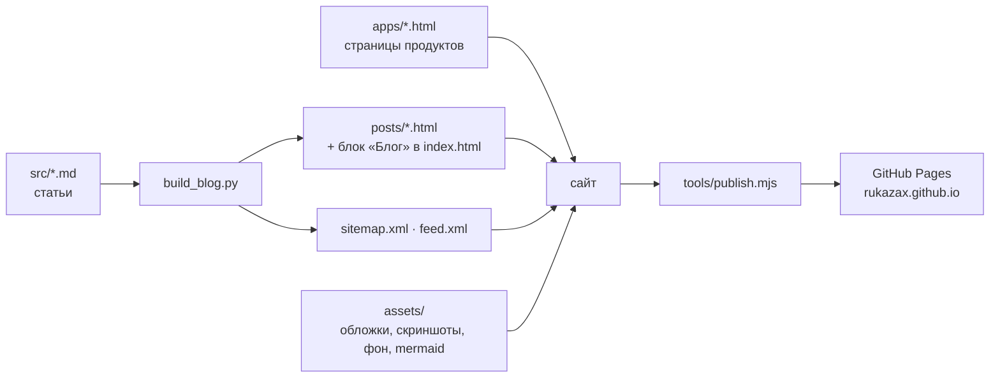

# rukazax.github.io — сайт, продукты и блог

**Русский** | [English](README.md)

Сайт-визитка и блог разработчика: услуги, страницы продуктов и технические разборы.
Сайт собран как статика и публикуется через GitHub Pages — без серверной части и внешних CMS.

**Сайт:** https://rukazax.github.io/ · **English:** https://rukazax.github.io/en.html

## Что на сайте

| Раздел | Адрес | Что внутри |
|---|---|---|
| Услуги | [/](https://rukazax.github.io/) | предложение услуг, процесс работы, стек, форма заявки |
| English | [/en.html](https://rukazax.github.io/en.html) | англоязычная версия лендинга |
| Private SpeedDial | [/apps/private-speeddial.html](https://rukazax.github.io/apps/private-speeddial.html) | закладки и заметки для Chrome и Android |
| XIO | [/apps/xio-vpn.html](https://rukazax.github.io/apps/xio-vpn.html) | VPN на своих серверах: Android, Ubuntu, Windows |
| x1o | [/apps/x1o.html](https://rukazax.github.io/apps/x1o.html) | самохостная платформа ИИ-ассистентов |
| ECONA | [/apps/econa.html](https://rukazax.github.io/apps/econa.html) | исследовательский концепт кайт-солнечного катамарана |
| Блог | [/#blog](https://rukazax.github.io/#blog) | разборы продуктов и локализации DeepSeek Harness |
| RSS | [/feed.xml](https://rukazax.github.io/feed.xml) | лента статей |

## Как это устроено



Статьи пишутся в Markdown (`src/<slug>.md`), `build_blog.py` собирает из них страницы `posts/`,
обновляет список статей на главной и пересобирает `sitemap.xml` и `feed.xml`. Лендинг (`index.html`,
`en.html`), страницы продуктов и `404.html` — обычные HTML-файлы в общем стиле; единый CSS
(`assets/site.css`) и скрипт (`assets/app.js`) отвечают за темы, «бургер», модальную форму заявки
и её сообщения на двух языках.

## Структура репозитория

```
index.html              лендинг услуг (RU)
en.html                 лендинг услуг (EN)
404.html                страница «не найдено» в стиле сайта
apps/                   страницы продуктов: private-speeddial, xio-vpn, x1o, econa
posts/                  статьи блога (готовый HTML, генерируется)
src/                    исходники статей в Markdown
assets/                 site.css, app.js, обложки, скриншоты, рендеры ECONA, mermaid
build_blog.py           сборка: статьи, список статей, sitemap.xml, feed.xml
sitemap.xml             карта сайта (генерируется)
feed.xml                RSS-лента блога (генерируется)
tools/login.mjs         вход в GitHub по device-flow, сохраняет токен
tools/publish.mjs       публикация папки в GitHub Pages через REST API
tools/publish_site.mjs  публикация из репозитория (альтернативный скрипт)
tools/status.mjs        диагностика соединения с GitHub
tools/check_links.py    проверка ссылок: локальные файлы, якоря, внешние URL
tools/make_covers.py    генерация обложек 1200×630 в стиле сайта
.publishignore          что не публиковать в репозиторий (tools)
```

## Сборка и публикация

```bash
python build_blog.py            # статьи, список статей, sitemap.xml, feed.xml
python build_blog.py --check    # ничего не писать, только сравнить со сборкой на диске
python tools/check_links.py     # битые ссылки: локальные файлы, якоря, внешние URL

node tools/login.mjs            # один раз: device-flow вход в GitHub
node tools/publish.mjs          # загрузить папку в GitHub Pages
```

Токен нужен с правом `repo` и лежит вне репозитория —
`%USERPROFILE%\.dsh\secrets\github.json` (`{"token": "...", "login": "rukazax"}`).
Публикация идемпотентна и атомарна: файлы с совпадающим git-blob sha пропускаются, а весь набор
изменений уходит **одним коммитом** (Git Data API: blob → tree → commit → ref), поэтому в истории
нет коммитов «update <файл>» и недопубликованного состояния.

## Возможности сайта

| Возможность | Реализация |
|---|---|
| Тёмная и светлая темы | CSS-переменные + `localStorage`, форсирование через `?theme=light` |
| Меню без сворачивания | закреплённая шапка, «бургер» только на ширине до 900 px |
| Форма заявки | модальное окно, отправка на `rukazax@gmail.com` без почтового клиента; сообщения RU/EN по `lang` страницы |
| Две языковые версии | `index.html` (RU) и `en.html` (EN), переключатель в шапке |
| Диаграммы | Mermaid (локальная копия) и статичные PNG |
| Страницы продуктов | общий шаблон с шапкой, меню и телефоном |
| Индексация и лента | `sitemap.xml`, `feed.xml`, страница `404.html` в стиле сайта |

## Продукты

- **Private SpeedDial** — закладки и заметки для Chrome и Android с синхронизацией через ваше облако
  (AES-GCM, WebDAV/Nextcloud): https://github.com/rukazax/Private_SpeedDial
- **XIO** — VPN на своих серверах: установка VPS по SSH, протоколы Xray/REALITY, RIVET, AWG, Cloak;
  Android, Ubuntu, Windows: https://github.com/rukazax/xio_vpn
- **x1o** — самохостная платформа личных ИИ-ассистентов: единый API, очередь диалогов, учёт расходов,
  пуши. Репозиторий приватный, публичного сайта нет.
- **ECONA** — исследовательский концепт океанского кайт-солнечно-электрического катамарана:
  https://github.com/rukazax/econa · https://rukazax.github.io/econa/

## Контакты

Константин · [rukazax@gmail.com](mailto:rukazax@gmail.com) · [+7 (999) 802-40-40](tel:+79998024040) · [github.com/rukazax](https://github.com/rukazax)

## Лицензия

Код сайта и шаблоны — MIT (см. [LICENSE](LICENSE)). Тексты статей и изображения —
© Константин Ерёмин, использование по согласованию.
