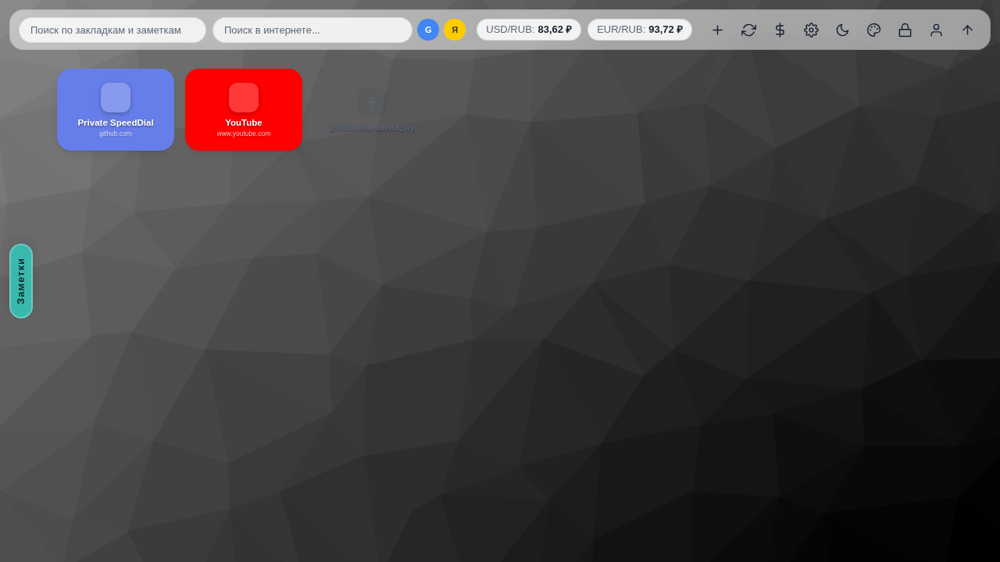
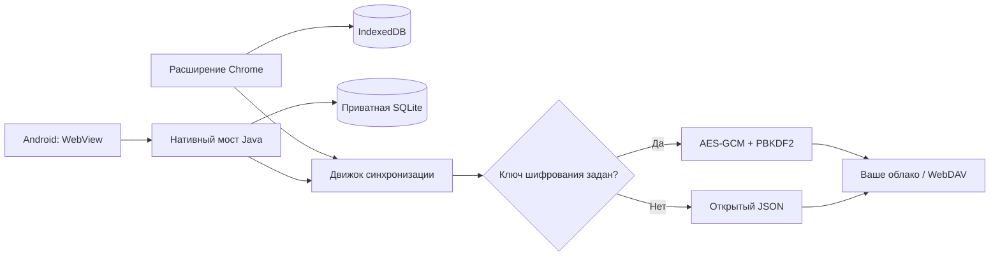

# Private SpeedDial: закладки, которые принадлежат вам

Обычные закладки живут внутри браузера: синхронизация идёт через аккаунт вендора, а на телефоне —
отдельный, часто несовместимый список. **Private SpeedDial** решает это иначе: плитки быстрого доступа
к сайтам, заметки и папки живут локально, а синхронизируются туда, куда вы сами укажете — в свой
Nextcloud, WebDAV или поддерживаемое облако.

Это два приложения с общим форматом данных: расширение Chrome (Manifest V3) и приложение для Android.
Интерфейс переведён на 13 языков, включая русский.

## Что умеет

| Возможность | Расширение | Android |
|---|---|---|
| Закладки, вложенные папки, заметки | Да | Да |
| Профили, темы, цвета, фоны | Да | Да |
| Синхронизация | Ручная и автоматическая | Пока приложение открыто |
| Пароли отдельных папок | Да | Да |
| Импорт JSON / HTML / CSV / FVD | Да | Да |
| Поиск по закладкам и заметкам | Да | В меню ☰ |

На десктопе дополнительно есть курсы валют, интернет-поиск, мастер-пароль с автоблокировкой и режим
«Не беспокоить». На телефоне этих функций нет намеренно: мобильная версия — про быстрый доступ, а не
про рабочий стол.

| Android: главный экран | Android: меню и заметки |
|---|---|
|  |  |

## Как устроена синхронизация

Обязательного сервера у проекта нет — и это главное архитектурное решение.

Файл синхронизации называется `private-speeddial.json`. Реквизиты подключения и ключ шифрования в
него не попадают — они остаются на устройстве. Поддерживаются три операции: объединение, загрузка на
сервер и скачивание с сервера; есть учёт времени изменений и удалений, история и обработка
первоначального конфликта.

## Приватность без иллюзий

Авторы честно пишут то, что обычно опускают: **приватность не означает отсутствие сети**. Ваш
облачный провайдер, сервис иконок, фоны по URL и GitHub видят метаданные соответствующих запросов.
Локальная база не шифруется самим приложением, а пароль папки — это защита от случайного взгляда, а
не от доступа к устройству. Полный разбор — в `docs/SECURITY.md` репозитория.

Зато нет центральной регистрации, нет аккаунта проекта и нет сервера, который хранит ваши закладки.

## Импорт и переезд

Данные не заперты в формате приложения: импорт из JSON, HTML, CSV и FVD (формат Speed Dial из
старых расширений), экспорт в JSON и HTML. Переезд с другого менеджера закладок — это несколько
кликов, а не ручной перенос.

## Связка с мобильным приложением

Расширение и Android-приложение — не два разных продукта, а две половины одного: общий формат данных,
один файл синхронизации `private-speeddial.json`, одинаковые папки, заметки и профили. Добавили
закладку на телефоне — она приезжает на компьютер при следующей синхронизации, и наоборот.

- **Android 8.0+**, APK ставится поверх старой версии, данные сохраняются.
- **Синхронизация на телефоне** работает, пока приложение открыто; на компьютере — по расписанию и вручную.
- **Ключ шифрования** задаёте вы: без него данные уходят обычным JSON, с ним — AES-256-GCM.
- **Пароли папок** и мастер-пароль есть в обеих версиях.

Ссылки: [приложение для Android (APK)](https://github.com/rukazax/Private_SpeedDial/releases/latest/download/Private-SpeedDial-Android.apk) ·
[расширение в Chrome Web Store](https://chromewebstore.google.com/detail/private-speeddial/eakakaeklcgnlanmpbndhjdljppehdof) ·
[исходники и релизы](https://github.com/rukazax/Private_SpeedDial) ·
[страница приложения с экранами](https://rukazax.github.io/apps/private-speeddial.html).

## Обновления

Расширение из Chrome Web Store обновляет сам браузер. Android-приложение раз в неделю (и не чаще)
спрашивает GitHub Releases о новой версии и предлагает обновиться — **установку всегда выполняет
пользователь**, автоматической установки кода нет. Кнопка «Пропустить релиз» запоминает конкретную
версию на конкретном устройстве.

## Установка

- [Private SpeedDial в Chrome Web Store](https://chromewebstore.google.com/detail/private-speeddial/eakakaeklcgnlanmpbndhjdljppehdof)
- [APK для Android 8.0+](https://github.com/rukazax/Private_SpeedDial/releases/latest/download/Private-SpeedDial-Android.apk)
- [Исходники и релизы на GitHub](https://github.com/rukazax/Private_SpeedDial)

Расширение не заменяет новую вкладку автоматически и не пытается быть «умнее» браузера: это
отдельная панель, которая открывается по клику или `Ctrl+Shift+Y`.

## Кому подойдёт

Тем, у кого уже есть Nextcloud или WebDAV и кто не хочет отдавать список закладок третьей стороне.
Тем, кто пользуется и браузером, и Android-телефоном и устал от двух несвязанных списков. И тем, кому
важно, что проект можно почитать, собрать и проверить самостоятельно.
