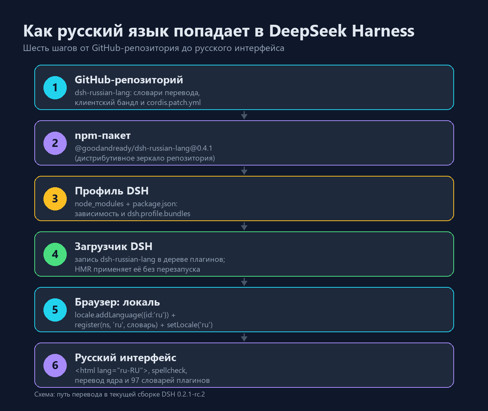
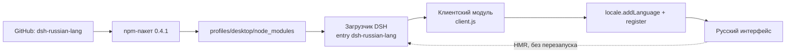
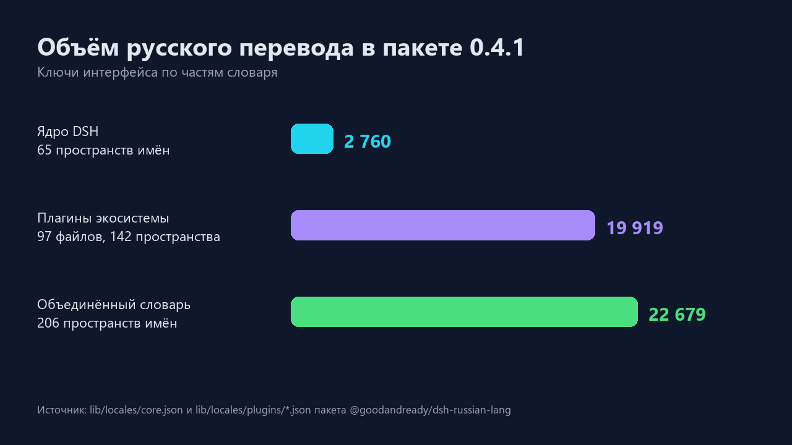

# Русский язык для DeepSeek Harness: как сообщество сделало локализацию, а я её установил

**TL;DR.** DeepSeek Harness (DSH) — англоязычный агентский харнесс. Русский интерфейс для него делает
не команда DeepSeek, а сообщество: плагин `@goodandready/dsh-russian-lang`. Внутри — около 22 тысяч
переведённых строк, собственный клиентский бандл и штатное API локализации DSH. Установка занимает
несколько минут, перезапуск приложения не нужен, а откат делается удалением одной папки.

---

## Что такое DSH и почему он на английском

DeepSeek Harness — это рабочее место для ИИ-агента: чат, дерево файлов, терминал, планировщик задач,
субагенты, трассировка вызовов инструментов. Всё это живёт в веб-интерфейсе, который десктопное
приложение открывает в окне Electron, а тот же сервер можно открыть и в обычном браузере.

Ядро DSH изначально поддерживает два языка — английский и китайский. Переводить интерфейс на другие
языки можно, но только «руками»: каждая подпись в интерфейсе — это ключ в словаре, и переводить нужно
именно ключи, а не текст на экране.

## Где нашёлся перевод

На GitHub нашлось сразу несколько независимых попыток русификации:

| Репозиторий | Что внутри |
|---|---|
| [GooDAnDReaDY/dsh-russian-lang](https://github.com/GooDAnDReaDY/dsh-russian-lang) | Полная локализация ядра и ~85 плагинов экосистемы, npm-пакет, типографика, инспектор перевода |
| [AbsoluteMikhail/dsh-locale-ru](https://github.com/AbsoluteMikhail/dsh-locale-ru) | Полная русификация веб-интерфейса |
| [nemezida1337/dsh-locale-russian](https://github.com/nemezida1337/dsh-locale-russian) | Языковой пакет и пайплайн перевода |
| [Balla1ore/dsh-locale-ru](https://github.com/Balla1ore/dsh-locale-ru) | Строки веб-интерфейса и оболочки |

Я взял первый: он заявлен под DSH `0.2.1-rc.2` — ровно та версия, что стояла у меня, — и
распространяется как обычный npm-пакет `@goodandready/dsh-russian-lang@0.4.1`.

> Важно: это плагин, а не форк приложения. Он не патчит `.exe`, не ломает обновления и не требует
> правки файлов установки. Всё живёт в профиле пользователя.



## Как это устроено внутри

DSH — приложение на [Cordis](https://github.com/cordiverse/cordis): всё, включая интерфейс,
собирается из плагинов. У плагина есть две половины:

- **хостовая** (`lib/index.js`) — выполняется в Node.js, здесь же объявляется схема настроек;
- **клиентская** (`lib/client.js`) — обычный JS-файл, который браузер загружает как модуль
  `@goodandready/dsh-russian-lang`.

Пакет объявляет в `package.json` два важных поля:

```json
{
  "dsh": {
    "bundle": { "patch": "./cordis.patch.yml" },
    "client": {
      "platform": "web",
      "inject": ["@deepseek-ai/dsh-client-locale",
                 "@deepseek-ai/dsh-client-ui-settings",
                 "@deepseek-ai/dsh-client-ui-slots"]
    }
  }
}
```

`bundle.patch` — это фрагмент конфигурации, который добавляет запись плагина в дерево загрузчика.
`client` — описание браузерной половины: какой модуль грузить и от каких плагинов она зависит.

А сам перевод регистрируется через штатное API локализации DSH
(`@deepseek-ai/dsh-client-locale`):

```js
// упрощённо, по мотивам lib/client.js
runtime.addLanguage({ id: 'ru', label: 'Русский', fallback: 'en' })
runtime.register('settings', 'ru', { /* словарь пространства имён */ })
runtime.setLocale('ru')
```

Дальше `t('settings.language')` в любом плагине возвращает русскую строку — без перезагрузки
страницы, потому что DSH перерисовывает подписи по событию смены локали.



Отдельно стоит заметить, как DSH доставляет клиентские модули: хост-половина сканирует включённые
записи загрузчика, собирает «граф загрузки» и отдаёт бандлы по адресам вида
`/plugins/??…&rev=…`. Страница получает этот граф по SSE (`/plugins/events`) и подхватывает новые
плагины на лету.

## Журнал установки

Всё делалось на Windows, профиль `desktop`, DSH `0.2.1-rc.2`.

**1. Пакет в профиль.** Распаковал дистрибутив в
`%USERPROFILE%\.dsh\profiles\desktop\node_modules\@goodandready\dsh-russian-lang`.

**2. Манифест профиля.** В `profiles\desktop\package.json` добавил зависимость и — главное — бандл:

```json
{
  "dependencies": { "@goodandready/dsh-russian-lang": "0.4.1" },
  "dsh": { "profile": { "bundles": [
    "@deepseek-ai/dsh-base",
    "@deepseek-ai/dsh-web-app",
    "@goodandready/dsh-russian-lang"
  ] } }
}
```

**3. Выбор языка.** В `profiles\desktop\cordis.patch.yml` — предпочтение локали:

```yaml
- id: locale
  name: "@deepseek-ai/dsh-client-locale"
  config:
    preference: ru
```

**4. Никакого перезапуска.** У DSH включён HMR для конфигурации профиля: он перечитал слои патчей,
поднял новую запись плагина, а открытая страница получила обновлённый граф модулей и загрузила
`client.js` сама.

## Как я проверял, что всё работает

Проверять «на глаз» скучно, поэтому смотрел на факты:

| Проверка | Результат |
|---|---|
| `GET /api/dsh-russian-lang/dict/core` | `200`, JSON со словарём ядра, ~159 КБ |
| `GET /api/dsh-russian-lang/dict/all` | `200`, 65 пространств имён |
| Граф клиентских модулей (`/plugins/events`) | содержит запись `{"id":"@goodandready/dsh-russian-lang","url":"plugins/??@goodandready/dsh-russian-lang/client.js&rev=…"}` |
| Отдача бандла | `200`, 168 540 байт, внутри `addLanguage`, `register(`, `ru-RU`, `spellcheck` |

То есть хостовая половина поднялась, клиентский модуль попал в граф и отдаётся браузеру — остаётся
открыть **Настройки → Общие → Язык** и убедиться, что выбран «Русский».

## Сколько там перевода

Плагин переводит не только ядро, но и десятки сторонних плагинов экосистемы — от канбан-досок до
менеджера контекста.



| Часть словаря | Пространств имён | Ключей |
|---|---|---|
| Ядро DSH | 65 | 2 760 |
| Плагины экосистемы (97 файлов) | 142 | 19 919 |
| **Объединённый словарь** | **206** | **22 679** |

Плюс мелочи, которые заметны в работе: правильные формы множественного числа («1 файл», «2 файла»,
«5 файлов»), ёлочки-кавычки и длинные тире, исправление текста, набранного в неверной раскладке
(<kbd>Alt</kbd>+<kbd>L</kbd>), инспектор перевода по <kbd>Alt</kbd>+<kbd>Click</kbd> и словарь
`<html lang="ru-RU">` для проверки орфографии браузером.

## Что не переводится и о чём стоит знать

- **Системное меню Electron** (File, Edit, Quit, Undo/Copy/Paste) принадлежит главному процессу
  приложения и веб-плагинами не переводится — это ограничение самого Electron, а не плагина.
- **Версионная совместимость.** У пакета в `engines.dsh` указан диапазон; при обновлении DSH
  плагин может потребовать обновления. Перед апдейтом харнесса проверяйте, что версия плагина
  поддерживает новую версию DSH.
- **Перевод ответов модели — отдельная функция.** По умолчанию движки перевода реплик выключены
  (`translateEngine: off`): интерфейс русский, а ответы модели — на языке запроса. Включать Google
  Translate стоит осознанно: текст уйдёт третьей стороне.
- **Агентский промпт** («отвечай по-русски») тоже опционален — по умолчанию выключен.

## Как повторить

Если у вас DSH с npm-доступом, всё сводится к одной команде:

```bash
dsh plugin --profile desktop add @goodandready/dsh-russian-lang
```

Дальше — **Настройки → Общие → Язык → Русский** и обновление страницы (<kbd>Ctrl</kbd>+<kbd>R</kbd>).

Если npm недоступен или хочется зафиксировать версию, работает и «ручной» путь из этой статьи:
распаковать пакет в `node_modules` профиля, добавить его в `dsh.profile.bundles` и выставить
`preference: ru`.

## Как откатить

Удалить папку плагина из `node_modules`, убрать его из `dependencies` и `dsh.profile.bundles`,
удалить блок `id: locale` из `cordis.patch.yml`. Резервные копии манифеста и патча стоит сделать
заранее — я сохранял `package.json.bak` и `cordis.patch.yml.bak` и ни разу об этом не пожалел.

## Вывод

Русификация DSH — хороший пример того, как экосистема закрывает пробел быстрее вендора. Никакого
взлома и патчинга бинарников: плагин пользуется теми же API, что и штатные языки, а весь перевод
лежит в открытых JSON-словарях. Если вы работаете в DSH каждый день, русский интерфейс перестаёт
быть косметикой — на нём просто меньше спотыкаешься.

Спасибо авторам [dsh-russian-lang](https://github.com/GooDAnDReaDY/dsh-russian-lang) за словари и
клиентский бандл — эта статья лишь рассказ о том, как они устроены и как их включить.

