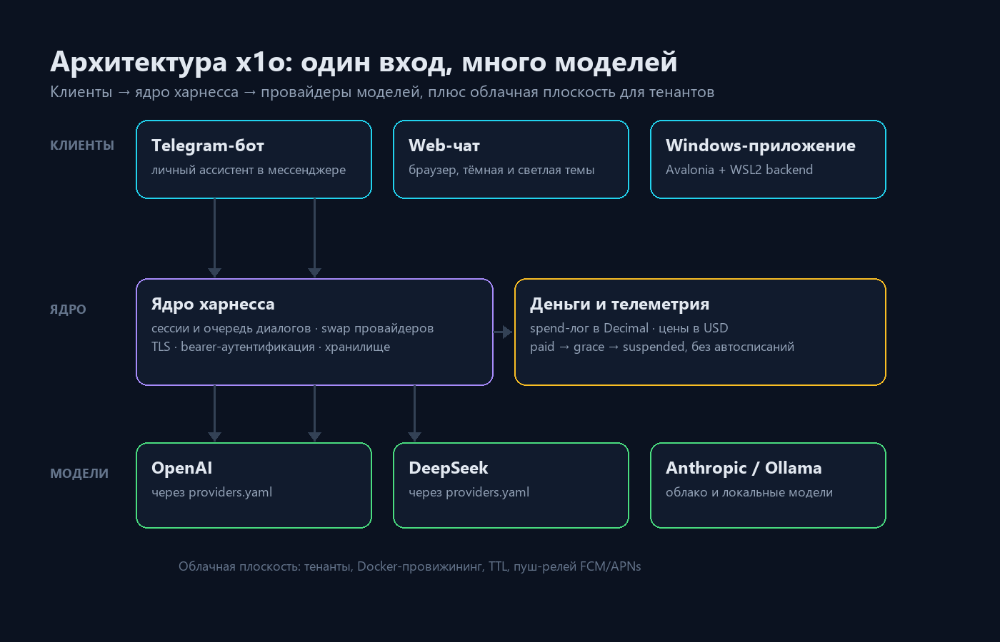

# x1o: один харнесс для всех моделей

## Что это

**x1o** — самохостная платформа личных ИИ-ассистентов. Это харнесс-оркестратор: он превращает набор
LLM-API в готовый продукт. Пользователь открывает Telegram, браузер или Windows-приложение и общается
со своим ассистентом, а харнесс решает, какой моделью отвечать, где хранить историю, сколько это
стоит и как не пропустить ответ.

Ключевые решения, на которых держится продукт:

- **Один вход, много моделей.** OpenAI, DeepSeek и Anthropic преднастроены, Ollama — для локальных моделей. Новый провайдер подключается конфигом `providers.yaml`, без кода.
- **Деньги под контролем.** Журнал расходов считает токены и оценку в USD по явно заданным ценам. Если цены нет, стоимость остаётся `null` — «ноль» и «неизвестно» это разные вещи.
- **Честный биллинг.** Статусы `paid → grace → suspended` с видимыми датами, автосписаний с карты нет by design.
- **Безопасность по построению.** Секреты только из окружения, fail-closed, подписанные вебхуки, ноль телеметрии.

## Архитектура

Платформа разделена на три слоя.

**Клиенты** — Telegram-бот, web-чат и Windows-приложение (Avalonia с WSL2-backend). Все они ходят в
один API, поэтому история, настройки и лимиты общие.

**Ядро** — сессии и очередь диалогов, переключение провайдеров, TLS и bearer-аутентификация,
хранилище. Запрос не теряется при смене модели и не дублируется при обрыве связи.

**Модели** — провайдеры, описанные конфигом. Рядом живёт денежный контур: журнал расходов в
`Decimal`, цены в USD и агрегации по дню и месяцу.

Отдельно есть **облачная плоскость**: тенанты, Docker-провижининг, TTL и пуш-релей FCM/APNs — для
тех, кто ставит платформу не только себе.

## Лицензия

Собственный код — **MIT**: можно использовать, изменять и распространять, в том числе в закрытых
продуктах, при сохранении текста лицензии. Сторонние зависимости сохраняют свои лицензии — их перечень
лежит в репозитории проекта.

Репозиторий закрыт: x1o находится в активной разработке, публично доступен сайт
[x1o.org](https://x1o.org). Обзор продукта — на [странице x1o](https://rukazax.github.io/apps/x1o.html). Эта заметка — обзор продукта, а не инструкция по установке.
