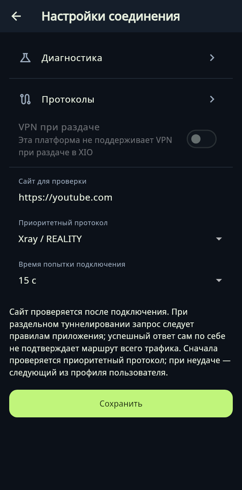

---
title: XIO: VPN, который живёт на вашем сервере
---

# XIO: VPN, который живёт на вашем сервере

Большинство VPN-приложений устроены одинаково: чужой сервер, подписка, закрытые протоколы и
доверие к оператору «на слово». **XIO** переворачивает схему: у вас есть свой VPS, приложение
ставит на него сервер по SSH, а клиент на телефоне или компьютере просто подключается к вашему
же серверу. Название расшифровывается как *X in 1 out* — много протоколов внутрь, один интерфейс
наружу.

## Что умеет

- ставить и обслуживать VPN-сервер на VPS по SSH, управлять пользователями, отзывать и экспортировать доступ;
- автоматически определять формат сторонних конфигураций при импорте;
- держать приоритет протоколов, таймаут попытки и HTTPS-проверку после подключения (по умолчанию `youtube.com`);
- собирать мультипротокольные профили пользователя и делегировать администрирование с лимитами активных пользователей;
- на Android — раздельное туннелирование, системная тема, выбор иконки, плитка в быстрых настройках и 13 языков;
- на рутованном Android — раздача VPN-соединения; на Windows — экспериментальная интеграция с ICS.

## Протоколы

Ядро приложения умеет несколько транспортов, и это не «список для галочки»: у каждого свой сценарий.

| Протокол | Зачем нужен |
|---|---|
| Xray / REALITY | основной рабочий вариант с маскировкой под чужой TLS-сайт |
| RIVET / S1 и RIVET / H3 | экспериментальный собственный транспорт (TCP и HTTP/3) |
| AWG | AmneziaWG — WireGuard с обфускацией |
| Cloak | обёртка трафика под браузерный TLS |

Раздел **Настройки → Соединение** — это и есть вся «политика подключения»: сайт для проверки,
приоритетный протокол, время попытки.

| Настройки соединения | Протоколы |
|---|---|
|  |  |

Логика простая: если приоритетный протокол не поднялся за отведённое время, клиент пробует
следующий из профиля пользователя. Никаких ручных переключений в три часа ночи.

## Платформы

| Платформа | Состояние |
|---|---|
| Android 8+ | APK для ARM64, ARMv7, x86_64; ARM64 физически проверен на POCO X6 5G |
| Ubuntu x64 | DEB и портативный архив, системные тесты на Ubuntu 24.04 |
| Windows 10/11 x64 | тестовый ZIP: интерфейс проверен в Wine, нативный драйвер и ICS ждут теста на Windows |
| iPhone / iPad | исходный проект Xcode, подписанного IPA нет — валидация Apple впереди |

Авторы не притворяются, что всё готово: статусы в таблице — это честная карта зрелости, а не
маркетинг.

## Чего VPN не обещает

Этот раздел стоит прочитать до покупки VPS. Даже с TLS провайдер видит входной IP. Строгий allowlist
требует доступного ingress: переименовать сайт в конфиге и «пробить» заблокированный сервер нельзя.
Сборка не тестировалась на сетях российских операторов, а RIVET — экспериментальный протокол без
независимого аудита и без доказанной неотличимости от браузера.

Иными словами, XIO — это инструмент для тех, кто готов администрировать свой сервер и понимать
ограничения, а не «кнопка, которая всё решает».

## Лицензия и поддержка

Собственный код — **GPL-3.0-only**, сторонние зависимости сохраняют свои лицензии (полные тексты
лежат в репозитории). Проект развивает Константин Ерёмин; поддержать можно на
[x1o.org/pay](https://x1o.org/pay).

- [Исходники и релизы](https://github.com/rukazax/xio_vpn)
- [Сборки и загрузки](https://github.com/rukazax/xio_vpn/releases) — APK, DEB, ZIP и исходники

## Кому подойдёт

Тем, у кого есть свой VPS и кто хочет управлять доступом сам: выдавать и отзывать пользователей,
экспортировать конфиги, не зависеть от чужой подписки. Тем, кому нужен один клиент на Android,
Ubuntu и Windows. И тем, кто ценит открытый код: приложение можно собрать и проверить, а не
доверять закрытому бинарнику.

